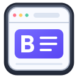

<p align="center">
  
</p>

<h1 align="center">Browzen</h1>

<h2 align="center"><strong>Browse by Browzen, private by design.</strong></h2>

<p align="center">
  Browzen is a portable Windows browser built on real Chromium rendering.<br>
  Browse with familiar tabs, DevTools, screenshots, Incognito, favorites, history, and modern website support.<br>
  No installer, Browzen account, telemetry service, or cloud sync is required.
</p>

<p align="center">
  <a href="https://drive.proton.me/urls/WFQATFBMRR#GS2xemqNwFeY">
    
  </a>
</p>

<p align="center"><sub>No installer. Download, open, and browse.</sub></p>

## Why we made Browzen

We wanted a browser that is easy to carry, simple to understand, and respectful of the person using it—without requiring an installer, Browzen account, telemetry service, or cloud sync.

## How Browzen is different

Browzen is a single movable executable. Run it from a folder or USB drive while its profile remains safely in your Windows user folder. Its interface keeps the essential tools of a general-purpose Chromium browser without tying browsing data to a vendor account.

## Privacy

Browzen sends no Browzen telemetry and uses no Browzen cloud sync. Browsing data stays on this device and is protected inside an encrypted local vault after Browzen closes normally. Incognito data is memory-only. While Browzen is running, the unlocked profile exists locally so Chromium can use it; an unclean shutdown may leave recovery data until Browzen closes cleanly.

## Responsible use

Use Browzen only in compliance with applicable laws and third-party rights. You are responsible for your activity. Browzen is provided “as is,” without warranties. To the maximum extent permitted by law, NeuralNexusLab and contributors are not liable for loss, damage, data loss, or claims arising from its use.

## Made by NeuralNexusLab

Browzen is created by [NeuralNexusLab](https://nxlabtw.com).

## Run

```powershell
.\Browzen.exe
```

Use `Ctrl+T` for a new tab, `Ctrl+Shift+N` for Incognito, `Ctrl+L` for the address bar, `Ctrl+H` for History, and `F12` for Developer Tools.

The Windows executable is provided through the download button above and is not stored in this repository.

## License

Licensed under the Apache License 2.0.
